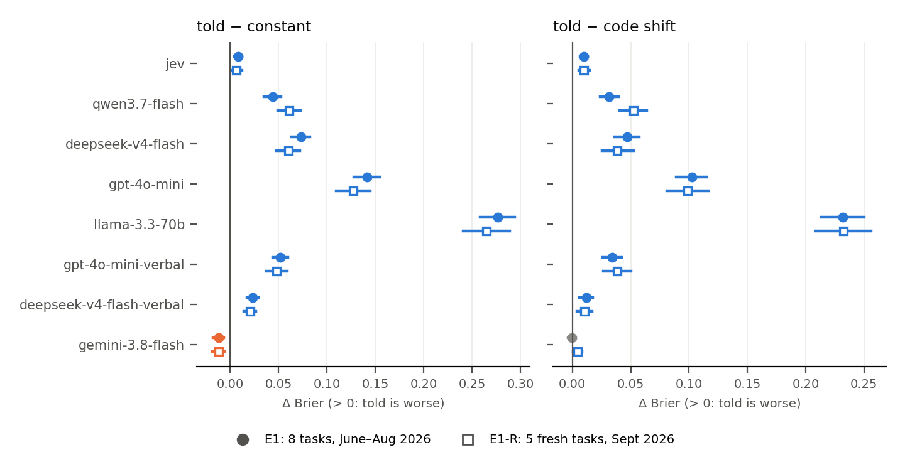

# Put the base rate in code, not in the prompt

**A small, preregistered study of a common LLM-probability habit.** You ask an LLM for the probability that a case
is a "yes" (will this complaint close within a week, will this PR be merged). You also know roughly how often the
answer is yes, say 20%. Should you tell the model that number in its prompt, or leave the prompt alone and apply the
number to its scores in code?

**Short answer, on these tasks:**
- **Applying the number in code beat telling the model.** In the preregistered replication on fresh data, the code
  shift had a lower Brier score than telling for all 9 model configurations (Holm-corrected; the smallest gap, Gemini's,
  is marginal). On the original data (E1), where this pooled test was post hoc, it held for 8 of 9, with Gemini null.
  Across all 117 model × task cells, telling was never significantly better after correction.
- **Telling the model the base rate usually did worse than ignoring the model altogether** and predicting the base
  rate as a constant: 8 of 9 configurations. The exception was the configuration that ranked these tasks best
  (Gemini 3.8 Flash), where telling beat the constant.
- **Scope:** these are low-signal tasks (most models' zero-shot AUROC was 0.52–0.71). Where a model ranked a task well
  (AUROC > 0.75), telling beat or tied the constant. My stricter preregistered per-task criterion failed for 7 of 9
  configurations. See [Scope and limits](#scope-and-limits).

The code fix is one line of arithmetic: add one constant to the log-odds of every prediction, chosen so that the
average prediction over a batch of *unlabelled* inputs equals the base rate.



*Positive = telling the model is worse. Filled circles: the 8 original tasks (E1). Open squares: the preregistered
replication on 5 fresh September 2026 samples (E1-R). Bars: 95% paired-bootstrap CIs.*

## Setup
- **Tasks.** Binary outcomes from public 2026 records, each written as a one-line case description:
  NYC 311 complaint closed within 7 days · Chicago crime report leads to an arrest · Sonoma shelter animal adopted or
  returned · Pittsburgh flight arrives > 15 min late · Stack Overflow question gets an accepted answer · Hacker News
  story reaches 10 points · GitHub PR merged · Chicago food inspection fails.
  - Each task has 300 test cases and 300 unlabelled "pool" cases.
  - **E1** used records from June–August 2026 (8 tasks).
  - **E1-R** re-drew 5 of the tasks from **September 2026**, after every model's training cutoff. It was preregistered
    before any model saw that data, as a confirmatory test of patterns first seen in E1. (Shelter and Stack Overflow
    had too few fresh rows; September flight data was not yet published.)
- **Models: 9 configurations from 7 providers**, each pinned to one provider via OpenRouter.

  | Probability read from | Configurations |
  |---|---|
  | First-token log-probabilities | Qwen3.7-Flash, DeepSeek-V4-Flash, GPT-4o-mini, Llama-3.3-70B |
  | Stated in text | Gemini 3.8 Flash, Claude Haiku 4.5, and GPT-4o-mini and DeepSeek-V4-Flash asked this way too |
  | Native output | Jev 1.13 (TypeSafe), a decision model that returns probabilities directly |

  Three more configurations were run afterwards as preregistered single-model checks (E2, E3; see
  [Extensions](#extensions-preregistered-single-model-checks)): a stronger logprob model and two reasoning models.
- **The base rate a team would know.** Each seed draws 100 labelled pool cases and rounds their yes-rate (e.g. "22%").
  Three seeds give three slightly different numbers; every arm uses the same number.
- **Arms:**
  - **told:** the prompt gains one sentence: *Base rate: across all cases like these, the answer to "…" is yes about
    22% of the time.* (E1 also tested two other wordings.)
  - **code shift:** the prompt is unchanged. Add one constant b to the logit of each zero-shot probability, chosen so
    the average prediction over the 300 *unlabelled* pool cases equals 22%. It uses no labels beyond the number.
  - **constant:** predict 22% for every case.
  - **Reference arms** trained on the same 100 labels: Platt scaling of the zero-shot scores; logistic regression on
    the cases' structured fields.
- **Statistics.** Brier score (log loss as a check). Paired bootstrap over test cases (B = 5000), resampling within
  each task when pooling tasks. Pooled estimate per model = mean over tasks of the per-task, seed-averaged difference.
  Holm correction across the 9 configurations. Preregistrations, predictions and every deviation are in
  [docs/RESEARCH_AGENDA.md](docs/RESEARCH_AGENDA.md) and [docs/AUTONOMOUS_LOG.md](docs/AUTONOMOUS_LOG.md).

## Results
Mean Brier difference over tasks; positive means telling is worse. **E1-R is the preregistered confirmatory test**;
E1 is shown as a point estimate (in E1 this pooled test was post hoc). All E1-R differences below are significant after
Holm across the 9 configurations, and all 3 seeds have the same sign in every E1-R row.

| Model | Probability from | $ / 1k decisions | Zero-shot AUROC (E1 / E1-R) | Told − constant, E1 | **Told − constant, E1-R** [95% CI] | Told − code shift, E1 | **Told − code shift, E1-R** [95% CI] |
|---|---|---|---|---|---|---|---|
| Jev 1.13 | native | 0.004 | 0.59 / 0.62 | +0.008 | +0.006 [+0.001, +0.012]¹ | +0.010 | +0.010 [+0.005, +0.015] |
| Qwen3.7-Flash | logprob | 0.005 | 0.58 / 0.60 | +0.044 | +0.061 [+0.049, +0.073] | +0.032 | +0.052 [+0.041, +0.064] |
| DeepSeek-V4-Flash | logprob | 0.006 | 0.55 / 0.57 | +0.073 | +0.060 [+0.048, +0.072] | +0.047 | +0.039 [+0.025, +0.052] |
| GPT-4o-mini | logprob | 0.020 | 0.55 / 0.57 | +0.141 | +0.127 [+0.110, +0.144] | +0.102 | +0.098 [+0.081, +0.117] |
| Llama-3.3-70B | logprob | 0.027 | 0.58 / 0.63 | +0.276 | +0.265 [+0.241, +0.289] | +0.232 | +0.232 [+0.209, +0.256] |
| GPT-4o-mini | stated | 0.009 | 0.52 / 0.54 | +0.052 | +0.048 [+0.037, +0.059] | +0.034 | +0.038 [+0.027, +0.050] |
| DeepSeek-V4-Flash | stated | 0.003 | 0.55 / 0.56 | +0.023 | +0.020 [+0.014, +0.027] | +0.012 | +0.010 [+0.004, +0.017] |
| Claude Haiku 4.5 | stated | 0.084 | 0.55 / 0.58 | +0.020 | +0.016 [+0.010, +0.023] | +0.013 | +0.010 [+0.005, +0.016] |
| Gemini 3.8 Flash | stated | 0.027 | 0.69 / 0.71 | −0.012 | −0.012 [−0.019, −0.006] | −0.001 (n.s.) | +0.004 [+0.000, +0.008]¹ |

¹ Marginal: p ≈ 0.03 (stable across 30 bootstrap seeds and an analytic z-test). Each is the largest p in its Holm
family, so it passes at 0.05, but only just. Gemini's told − shift was *predicted* to be null.

For scale: the constant's Brier is about 0.15 on a task where 20% of cases are yes, so +0.05 is about a third worse
than "always say 20%". Full tables, per-task counts and seeds: [results/v2/replication_table.md](results/v2/replication_table.md).

**Per cell.** Across all 117 model × task cells (9 configurations × 13 task datasets), telling was never significantly
better than the code shift after Holm correction within each model; the shift was significantly better in 47 (28 if
Holm is applied across all 117 cells at once). Without correction, 3 cells favoured telling.

**Why telling loses.** It moves the model's average prediction only partway toward the stated rate, or past it: on
NYC 311, told 80–88%, the logprob versions of GPT-4o-mini, DeepSeek and Llama averaged 0.95–0.97. It doesn't improve
ranking (AUROC is about the same told and zero-shot). The code shift sets the average exactly and keeps whatever
ranking the model has.

### Extensions (preregistered single-model checks)
| Model | What it tests | Told − constant, E1 / E1-R | Told − code shift, E1 / E1-R |
|---|---|---|---|
| DeepSeek-V4-Pro (logprob) | a stronger model | +0.051 / +0.042 [+0.033, +0.051] | +0.030 / +0.029 [+0.019, +0.038] |
| GPT-5-mini, reasoning (stated) | reasoning before answering | +0.033 / +0.015 [+0.008, +0.023] | +0.028 / +0.009 [+0.003, +0.014] |
| DeepSeek-V4-Flash, reasoning (stated) | the same model with and without thinking | +0.022 / +0.019 [+0.013, +0.026] | +0.007 / +0.011 [+0.006, +0.017] |

All 12 differences are > 0 (p ≤ 0.008, uncorrected; each is its own preregistered check) and all seeds agree. Reasoning did not rescue telling for these two models:
DeepSeek-V4-Flash with thinking behaves like its non-thinking twin (told − shift +0.011 vs +0.010 on the fresh data).

## Scope and limits
**What failed or was narrowed (full list in [CLAIMS.md](CLAIMS.md)):**
- **My first preregistered test failed its own bar.** It required the shift to beat telling on at least 5 of 8 tasks
  *per model*. Only 2 of 9 configurations passed (GPT-4o-mini and Llama-3.3, logprob). Per-task differences are often
  small. The pooled pattern was noticed after looking at E1, which is why it was re-tested on fresh data (E1-R).
- **"Telling is worse than the constant" is a low-signal-task result.** In the 5 cells where a model's zero-shot AUROC
  exceeded 0.75 (Gemini on NYC 311 and crimes, Jev on NYC 311), telling beat or tied the constant. In the 95 cells at
  or below 0.65, telling was significantly worse than the constant in 61 (57 after Holm within model) and better in 1.
  Ranking skill alone is not sufficient either: DeepSeek-V4-Pro ranks NYC 311 well (AUROC 0.80), yet when told the
  rate its average stayed at 0.57 against a stated 0.76, and its Brier was 0.29 against the constant's 0.16.
- **The one configuration that escaped** is best described as "a strong model stating its own probabilities", on the
  evidence of a single model.
- **No calibration trick rescues a model that can't rank the task.** For most of these models, even the best fix does
  not beat the constant. With 100 labels, Platt scaling brings them back to about the constant's level, and logistic
  regression on the same 100 labels beats the cheaper models' shifted scores.
- A preregistered prediction that the shift would beat the constant wherever AUROC ≥ 0.65 was refuted (P5).

**Other limits:**
- 8 task types from public records, with short, mostly structured case descriptions. Richer inputs may behave
  differently.
- One prompt template per elicitation style and three wordings of the base-rate sentence. Not tested: few-shot
  prompts, the rate in the system prompt, or free-form chain-of-thought (two reasoning models were tested).
- The CIs resample test cases, and the seeds vary the 100-label rate estimate. Model run-to-run noise is not resampled
  separately (most calls are at temperature 0).
- An earlier version of this data had label leaks in the shelter, GitHub and crimes tasks. They were repaired before
  any of these runs (`src/v2/leak_audit.py`, `src/v2/build_data.py`). The GitHub PRs are the top search results per
  repo, not a random sample.
- Results are for the model versions and providers listed, as of September 2026. Total API spend for v2 was $7.35
  (`results/v2/spend_ledger.csv`).

## Practical recipe
1. **Don't put the base rate in the prompt to "calibrate" the model.** Keep the prompt about the case.
2. **Shift in code.** Compute `b` so that `mean(sigmoid(logit(p) + b)) = base_rate` over a batch of *unlabelled*
   recent inputs, then use `sigmoid(logit(p) + b)`. It needs no labels, just the number.
3. **Always compare against the constant** (predict the base rate for every case) and against logistic regression on
   whatever labels you have. Here, models beat the constant mainly where their AUROC was above about 0.7.
4. **With about 100 labels, fit Platt scaling** (2 parameters). It beat the shift in 38 of 117 cells and lost in 2,
   helping most for logprob-read models, whose scores are too extreme.

## Claims ledger and the earlier study
This repo began as an exploratory study (v1, 2026-09-27) of in-context examples vs recalibration for a single model.
Before building on it, I red-teamed it ([docs/REVIEW_2026-09-27.md](docs/REVIEW_2026-09-27.md)) and withdrew 11 of its
claims: 3 inflated by label leaks, 1 confounded by a varying API provider route, and 7 that lacked a trivial baseline, overstated a statistic, or were never properly tested. A twelfth entry records an editorial removal, not a finding.
[CLAIMS.md](CLAIMS.md) lists every killed, surviving and v2 claim with its evidence, including the v2 predictions that
failed. The archived v1 write-up is in [docs/v1/](docs/v1/README_v1_2026-09-27.md); its results are not part of the
claims above.

**Independent re-verification (2026-09-30).** [verification/recompute_claims.py](verification/recompute_claims.py)
recomputes the headline numbers from the saved per-item predictions without importing any of the analysis code
(output: [verification/recompute_output.txt](verification/recompute_output.txt)). Every point estimate above matches
the repo's analysis exactly, and every significance call is unchanged. It also re-checks two v1 claims (S3, S4); see
CLAIMS.md for the caveats it found.

## Reproduce
Analysis runs from the committed predictions, with no API calls and no caches:
```
pip install -r requirements.txt
python src/v2/baserate_analyze.py                        # E1   -> results/v2/e1_{arms,tests,posthoc_pooled,summary}
V2_DATASET=v2_fresh python src/v2/baserate_analyze.py    # E1-R -> results/v2/e1r_*
python src/v2/final_tables.py                            # results/v2/replication_table.md, fig_headline.png
python verification/recompute_claims.py                  # independent recompute (about 1 minute)
```
E2/E3 analyses: `E_TAG=_e2 python src/v2/baserate_analyze.py <the 9 models> deepseek-v4-pro` and
`E_TAG=_e3 python src/v2/baserate_analyze.py deepseek-v4-flash-verbal deepseek-v4-flash-think gpt-5-mini-think`
(each also with `V2_DATASET=v2_fresh`). Re-running all of the above on 2026-09-30 reproduced every committed file in
`results/v2/` byte for byte.

Rebuilding the data and predictions (needs network access; model calls need `OPENROUTER_API_KEY` in `.env`):
```
python src/v2/build_data.py                    # repaired task data -> data/v2/        (from data/*.csv)
python src/v2/fresh_data.py                    # September 2026 data -> data/v2_fresh/ (public APIs)
python src/v2/baserate_exp.py <model>          # E1 predictions; V2_DATASET=v2_fresh for E1-R
```
Every API call's cost is logged to `results/v2/spend_ledger.csv`, and the client stops at a hard cap. The API response
cache (about 0.5 GB) is not in the repo.

## Repository layout
| Path | Contents |
|---|---|
| `README.md`, `CLAIMS.md` | this summary; the claims ledger |
| `docs/RESEARCH_AGENDA.md` | the v2 preregistrations (E1, E1-R, E2, E3) |
| `docs/AUTONOMOUS_LOG.md` | lab notebook of the v2 runs, including bug fixes and protocol deviations |
| `docs/REVIEW_2026-09-27.md`, `docs/NOVELTY_CHECK.md` | red-team review of v1; related-work check |
| `docs/DIGEST.md`, `docs/WEBSITE_DRAFT.md` | one-page summary; write-up draft |
| `docs/v1/` | archived v1 write-up and study plan |
| `src/v2/` | v2 code: data repair, clients with spend ledger, experiment, analysis, tables |
| `src/v1/` | v1 code (in-context examples vs recalibration; most scripts need the API caches) |
| `results/v2/`, `results/v1/` | per-item predictions, test outputs and tables |
| `data/` | task data: v1 (`data/*.csv`, `data/synthetic/`), repaired v2 (`data/v2/`), fresh (`data/v2_fresh/`) |
| `reports/progress/` | the two progress reports written during the v2 run |
| `logs/` | run logs |
| `verification/` | the independent recompute and its output |

Files were reorganised on 2026-09-30. Documents written earlier refer to the old paths: `v2/` is now `src/v2/`, the
top-level v1 scripts are in `src/v1/`, top-level `results/*` files are in `results/v1/`, and the Markdown documents
other than this README and CLAIMS.md are in `docs/`. The pre-reorganisation state is on the `old` branch.
